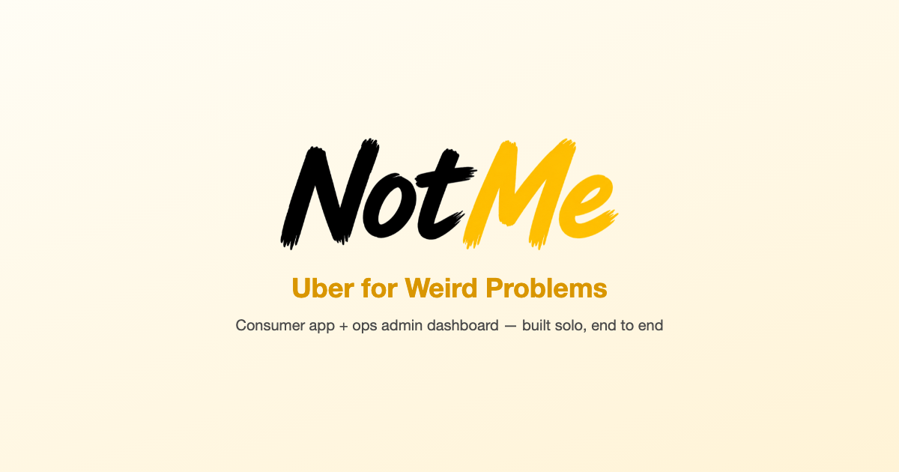

<div align="center">
  

  <p>
    <a href="https://notme-portfolio.vercel.app"><b>→ View the live site</b></a>
  </p>
</div>

# NotMe — Portfolio

Source for [notme-portfolio.vercel.app](https://notme-portfolio.vercel.app), the case-study site for **NotMe**: an on-demand marketplace MVP (consumer app + ops admin dashboard) designed, built, and shipped solo.

The live site covers the full build in more depth than a README can — product decisions, the request→match→complete→review flow for both user roles, and the engineering calls behind it (RLS + trigger-based authorization, race-condition-safe mission claiming, and more).

| | |
| --- | --- |
| 🚀 Live site | [notme-portfolio.vercel.app](https://notme-portfolio.vercel.app) |
| 📱 Consumer app | [github.com/elodiekim/not-me](https://github.com/elodiekim/not-me) |
| 🛠️ Admin dashboard | [github.com/elodiekim/not-me-admin](https://github.com/elodiekim/not-me-admin) · [live demo](https://not-me-admin.vercel.app) |

## Tech Stack

| Layer | Tech |
| --- | --- |
| Framework | Vite + React |
| Styling | Tailwind CSS |
| Language | TypeScript |

## Getting Started

```bash
npm install
npm run dev
```

Other useful scripts:

```bash
npm run build   # tsc -b && vite build
npm run lint    # oxlint
```
